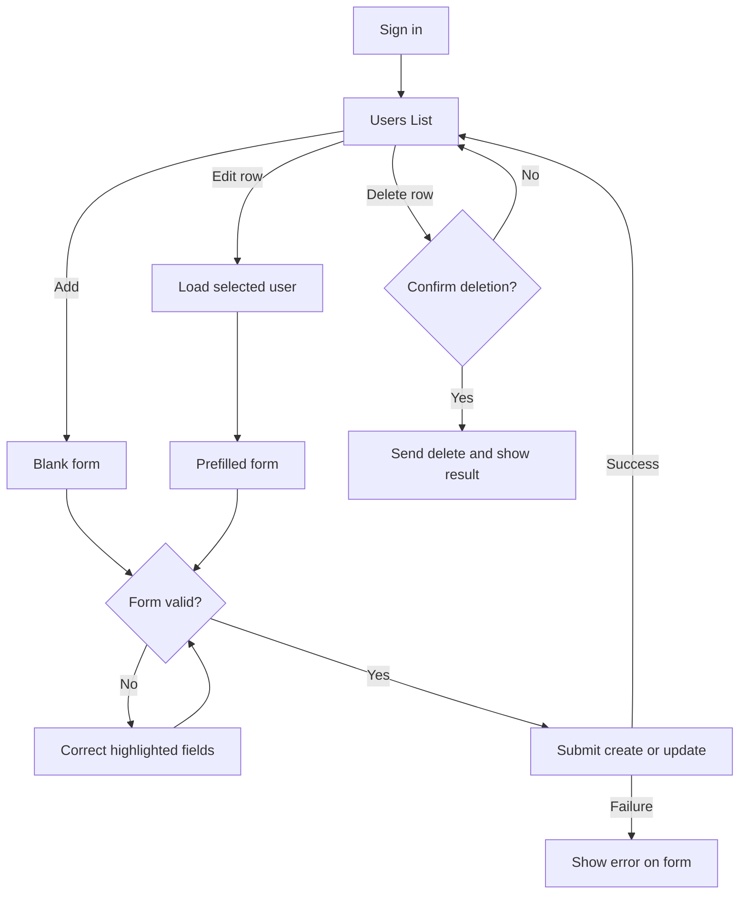

# User Management System

A React and TypeScript demo for working with a user directory. Sign in, browse user records, open the same form in create or edit mode, confirm a deletion, and inspect the signed-in user's profile. The frontend makes requests directly to DummyJSON. The directory is demo data; use the project to explore the interface and request lifecycle.

[Open the portfolio demo](https://user-management-system-orpin.vercel.app/)

## Run locally

Install Node.js and npm, then run the following from a terminal:

```sh
git clone https://github.com/onisEg/userManagementSystem.git
cd userManagementSystem
npm install
npm run dev
```

Open the local address printed by Vite. The API URLs are embedded in the components and point to `https://dummyjson.com`. The data screens require internet access. The sign-in screen is prefilled with demo credentials. Use demo accounts when reviewing this application.

| Command | Purpose |
| --- | --- |
| `npm run dev` | Start Vite with hot reload |
| `npm run build` | Run the TypeScript project build, then bundle the frontend into `dist/` |
| `npm run preview` | Serve the generated production build locally |
| `npm run lint` | Run ESLint on TypeScript and TSX files, treating warnings as failures |

## Routes and screens

| URL | Screen | Behavior |
| --- | --- | --- |
| `/` or `/login` | Sign In | Submit username and password. On successful token handling, navigate to the dashboard |
| `/dashboard` or `/dashboard/users` | Users List | Fetch the directory and show the available row actions |
| `/dashboard/home` | Home | Display the Home Page heading inside the dashboard layout |
| `/dashboard/userdata` | Add user | Start with a blank form and submit a new record |
| `/dashboard/userdata/:userId` | Edit User | Load the selected record by ID, prefill its fields, and submit an update |
| `/dashboard/profile` | Profile | Load the record identified by the signed-in user's token and display its details |

The dashboard opens on **Users List**. **Home** is a separate sidebar destination. The dashboard layout contains the collapsible sidebar, navbar, and a nested route outlet. The navbar displays a search input; it currently has no connection to the directory query. The route configuration mounts the dashboard layout directly and has no role-based route guard.

## User journey



### Sign-in, session, and profile

1. The login form requires both fields and submits them to the authentication endpoint.
2. The implementation reads `response.data.token`, writes it to local storage under `userToken`, and asks `AuthContext` to decode it. Check the actual response field name if a successful HTTP response still fails to open the dashboard.
3. On startup, the provider checks for a stored token in an effect and decodes it into shared user state. The profile component reads the decoded ID and requests the corresponding directory record.
4. Profile displays the user's image, first and last names, email, phone, age, and birth date. Editing directory records is handled by the separate User Data screen. Profile has no implemented save request.
5. Logout removes `userToken` from local storage and navigates to the root sign-in screen.

The login inputs use fixed demo values and the password input uses a visible text field. The application should only be used with demonstration credentials in its current form.

### Browse, create, edit, and delete

**Browse.** Opening the list triggers one GET request. The component reads the response's `users` array. Each row displays a picture, full name, email, phone, gender, and birth date. The client displays the page returned by the service. It does not request additional pages or implement directory-wide search.

**Create.** Choose the add-user action, complete the six fields, and submit. A successful POST shows a toast and returns to `/dashboard/users`, where the list is fetched again. An API failure displays an error and leaves the form open.

**Edit.** Choose a row's edit action. The URL carries the record ID. The editor shows a loading indicator, fetches that ID, and fills the form. It formats the birth date as `YYYY-MM-DD` for the date input. Submitting sends a PUT for the same ID. A failed detail request ends the loading state and shows an error, so check that the intended values loaded before submitting.

**Delete.** The confirmation dialog shows the selected user's name. **No** closes it without a request. **Yes** sends DELETE for the selected ID. Both success and failure close the dialog and show feedback. The current success handler leaves the component's list in memory as it was, so the row can remain visible following a success toast. DummyJSON simulates writes; the demo does not provide a durable user database.

### Editor fields

| Field | Input and client behavior |
| --- | --- |
| `firstName`, `lastName` | Required text fields |
| `email` | Required email input with a pattern check |
| `phone` | Required telephone input |
| `age` | Required numeric input with a maximum of 50 |
| `birthDate` | Required date input; existing dates are formatted during prefill |

## API reference

All paths below are relative to `https://dummyjson.com`. Components call Axios directly.

| Operation | Method and path | How the result is used |
| --- | --- | --- |
| Sign in | `POST /auth/login` | Sends username and password; the login handler expects a JWT in `token` |
| Read directory | `GET /users` | Stores `response.data.users` in the list component |
| Read one user | `GET /users/{id}` | Prefills the editor or displays the profile. Edit gets its ID from the URL; Profile gets its ID from context |
| Add user | `POST /users/add` | Sends the editor fields, shows feedback, and navigates to the list on success |
| Update user | `PUT /users/{id}` | Sends the editor fields to the selected record and returns to the list on success |
| Delete user | `DELETE /users/{id}` | Reports the API outcome in a toast and closes the confirmation dialog |

## Architecture and source guide

React 18 renders the application. React Router 6 handles browser-history navigation. React Hook Form registers fields and validates submissions. Axios handles HTTP calls, JWT Decode reads token claims, and React Toastify displays feedback. Bootstrap, React Bootstrap, icon libraries, and React Pro Sidebar provide interface elements. Vite and TypeScript build the distributable frontend.

| Source | Responsibility |
| --- | --- |
| [main.tsx](src/main.tsx) and [App.tsx](src/App.tsx) | Mount React, install the auth provider, load global styles, and define routes |
| [AuthContext](src/Context/AuthContext.tsx) and [Login](src/Components/Login/Login.tsx) | Restore the stored token, expose decoded user data, and handle sign-in |
| [AuthLayout](src/Components/AuthLayout/AuthLayout.tsx) and [MasterLayout](src/Components/MasterLayout/MasterLayout.tsx) | Render the sign-in and dashboard layouts |
| [Sidebar](src/Components/Sidebar/Sidbar.tsx) and [Navbar](src/Components/Navbar/Navbar.tsx) | Provide navigation, collapse controls, logout, and the top bar |
| [UserList](src/Components/UserList/UserList.tsx) and [Usertr](src/Components/UserInfo/Usertr.tsx) | Fetch the list, render rows, select a record, and confirm deletion |
| [UserData](src/Components/UserData/UserData.tsx) | Choose create or edit mode from the optional route parameter, validate fields, and submit |
| [Profile](src/Components/Profile/Profile.tsx) and [Home](src/Components/Home/Home.tsx) | Display the signed-in user's details and the separate home screen |

## Deployment and troubleshooting

Build with `npm run build` and serve `dist/` from a static host. React Router uses browser history. Configure the host to serve `index.html` for client-side paths, then check a direct visit and a refresh on a nested URL. A root-level `vercel.json` was absent from the reviewed revision. Host-side rewrites and the current production deployment were not verified during this documentation pass.

| Symptom | What to inspect |
| --- | --- |
| Login returns 200 but navigation fails | Compare the token field in the actual response with the field consumed by Login. Check whether the stored value is a decodable token |
| Profile works after sign-in but fails on a direct refresh | Auth restoration and the profile fetch both run in mount effects. The profile fetch depends on the decoded ID and does not rerun when the ID becomes available |
| A deleted row remains visible or a saved edit disappears | Inspect the success response, the local list update, and the behavior of simulated writes on the next GET |
| Search text has no effect | The navbar input has no filter handler; the list fetch uses the unfiltered endpoint |
| A nested URL works inside the app but returns a host 404 after refresh | Check the host's SPA fallback and the deployed output directory |

## Acceptance walkthrough

Use a demonstration record when reviewing write actions. These checks describe expected behavior from the source and give reviewers a repeatable way to compare it with the running app.

| Check | Steps | Expected observation |
| --- | --- | --- |
| Authentication | Submit the prefilled form and inspect the response and next URL | A compatible token results in a session and a transition to the user list; a failed login produces feedback |
| Directory navigation | Open the list, Home, and the list again | Home and the directory have distinct content |
| Add and validate | Open Add User, submit incomplete fields, then complete all fields and submit | Required fields show errors; a valid form sends POST and success returns to the list |
| Edit | Open a row, compare the loaded name and date, change a field, then submit | The detail GET and update PUT use the same ID |
| Cancel or confirm deletion | Open the named dialog, cancel, then reopen and confirm | Cancel sends no DELETE. Confirmation sends one for the selected ID and reports its outcome |
| Profile and logout | Open Profile after login, refresh it, then log out | Compare the profile before and after refresh. Logout removes the saved token and navigates to sign-in |
| Hosting | Open a nested route directly on the deployed domain | A correctly configured host serves the frontend and the router selects the intended screen |

**Verification scope.** This guide was checked against the repository source. Installation, lint, build, hosted sign-in, and end-to-end interactions were not executed during this documentation pass. The package defines no automated test script.

## Improvement priorities

1. Align login with the live demo API response, make the fields editable, mask the password, and handle an invalid stored token gracefully.
2. Distinguish session restoration from signed-out state, wait for the user ID before fetching Profile, and define which dashboard routes require authentication.
3. Reconcile directory state after simulated mutations. Communicate the demo's persistence limits in the UI.
4. Connect search and pagination to the directory, and give loading, empty, and error states distinct presentations.
5. Add regression coverage for login, profile refresh, add/edit branching, form validation, and deletion cancellation before relying on these flows in production.
